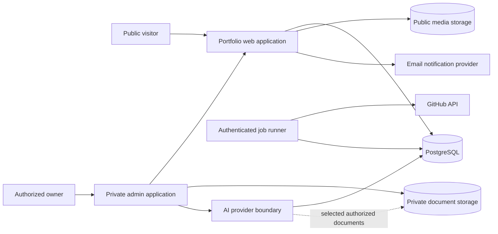
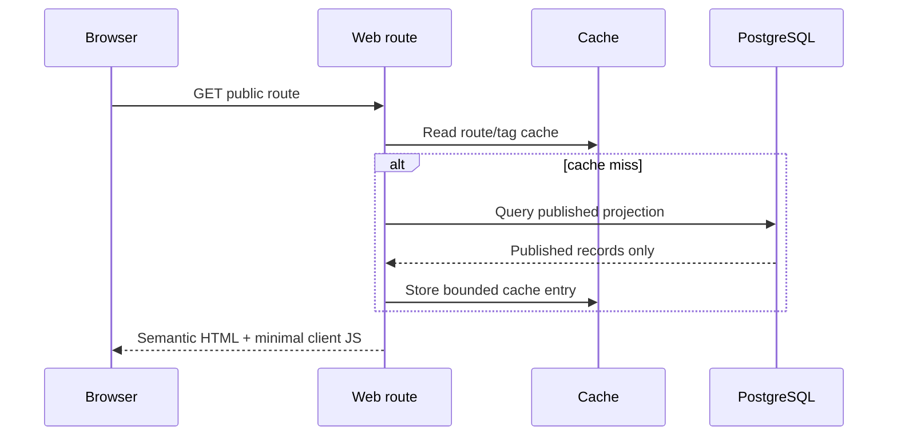
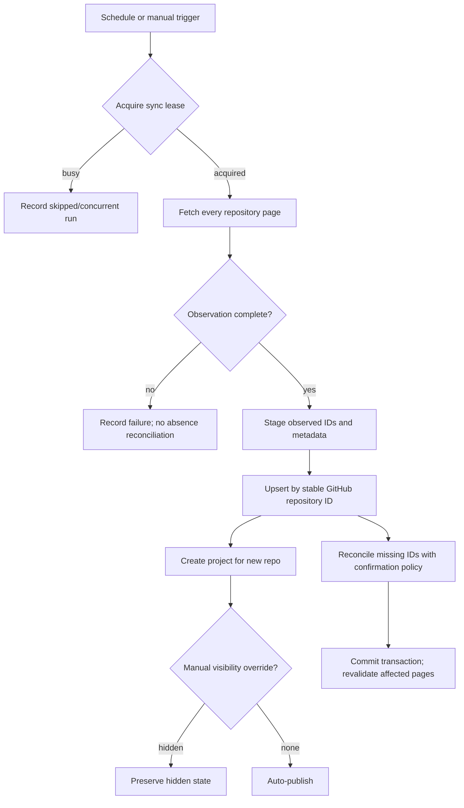
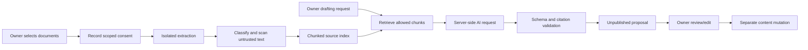

# Architecture

Status: Proposed baseline; provider-dependent choices remain pending owner approval.  
Last updated: 2026-10-09

## Decision summary

Use a TypeScript modular monolith with a React/Next.js-compatible server-rendered web layer, PostgreSQL as the system of record, a maintained authentication component with TOTP/passkey capability, and separate public and private object-storage policies. Background work runs through an authenticated job boundary. This keeps one deployable product while enforcing domain boundaries in code and data.

Current official documentation review found Next.js 16.3, React 19.3, and Tailwind CSS 4.3 current as of the review date. Versions will be pinned only during scaffolding after runtime/hosting compatibility is confirmed. React Server Component security advisories published in December 2025 make patch-level currency a release gate, not an optional upgrade.

Sources reviewed:

- https://nextjs.org/blog
- https://react.dev/blog
- https://tailwindcss.com/blog
- https://docs.github.com/en/rest/using-the-rest-api/using-pagination-in-the-rest-api
- https://docs.github.com/en/rest/using-the-rest-api/rate-limits-for-the-rest-api
- https://learn.microsoft.com/en-us/linkedin/shared/authentication/getting-access
- https://owasp.org/projects/asvs

## Context

## Application boundaries

### Web delivery

- Server-render public routes from published database records.
- Use targeted cache revalidation after publication and synchronization mutations.
- Do not call GitHub or AI providers during normal public page rendering.
- Keep admin route bundles and private data out of public payloads.

### Domain modules

| Module | Responsibilities |
|---|---|
| Identity | Admin allow-list, sessions, MFA state, reauthentication, recovery policy. |
| Publishing | Draft/public/archive lifecycle, ordering, previews, revisions, redirects. |
| Portfolio | Profile, experience, education, skills, achievements, research, publications, profiles. |
| Projects | GitHub source data, owner enrichment, filtering, stable slugs, visibility override. |
| Documents | Resume versions, public download selection, private reference documents, processing state. |
| AI assistance | Consent, source selection, retrieval, draft proposal, citations, cost/usage records. |
| Contact | Submission validation, anti-abuse, encrypted/restricted storage, inbox workflow. |
| Media | Metadata, public/private classification, upload validation, lifecycle. |
| Audit/operations | Immutable security-relevant events, job runs, health summaries, redacted logging. |

Module code may share a deployment and transaction manager but must not bypass service authorization or query private tables from public route handlers.

## Public request flow

## Admin mutation flow

1. Middleware performs a coarse session check but is never the sole authorization control.
2. The server action/API handler validates CSRF/origin as appropriate, session, allow-listed identity, MFA completion, and reauthentication for sensitive operations.
3. A strict schema validates input.
4. The domain service performs the mutation and revision/audit writes in one transaction where consistency requires it.
5. A cache invalidation event targets affected public routes/tags.
6. The response exposes no secrets or private fields.

## Authentication and authorization

- No sign-up route or public account creation.
- Initial bootstrap requires an out-of-band configured admin email/subject allow-list; bootstrap is disabled after the owner account exists.
- Prefer phishing-resistant passkeys when provider/runtime support is verified; require TOTP or equivalent MFA at minimum.
- Better Auth is a current self-hosted candidate because its official documentation provides TOTP, backup codes, lockout, passkey support, sessions, and server integrations. A managed identity provider remains an alternative. Final selection is `OWNER_DECISION`.
- Every protected operation calls a server-side policy function; UI visibility is not authorization.
- Session revocation, expiry, credential reset, MFA recovery, and sensitive-operation reauthentication require integration tests.

## GitHub synchronization architecture

Use GitHub's documented REST API through a server-side client. Authenticated requests are preferred for a sustainable rate budget, but the token must have the least privilege compatible with public repository metadata.

Key rules:

- Follow pagination links until exhaustion; never infer completion from a fixed count.
- Store ETag/Last-Modified where supported and rate-limit headers on each run.
- Separate `github_repositories` from owner-authored `projects`.
- A complete successful snapshot is necessary but may not be sufficient for destructive absence reconciliation; use consecutive complete misses or an explicit repository lookup before marking unavailable.
- Private/deleted source data stops publishing promptly but manual enrichment is retained as archived data rather than silently destroyed.
- Stable public slugs use a redirect table when renamed.
- README Markdown is sanitized with raw HTML disabled by default; remote images are proxied or allow-listed under an explicit policy.

## AI document processing

Document text is evidence, not instruction. The provider receives only selected minimal excerpts. Raw private text, prompts, and provider responses are excluded from ordinary logs. The public application remains functional if the provider is unavailable.

## Storage

- Public media: intentionally published, immutable or versioned object keys, cacheable delivery.
- Private documents: private bucket/prefix with public access disabled; opaque object keys; retrieval only after server authorization using short-lived signed access or streamed responses.
- Database stores metadata and access state, not large binaries.
- Quarantine is separate from accepted storage until validation/scan completes.
- Resume downloads use a controlled stable route that resolves the selected public version and applies safe content-disposition headers.

## API style

- Prefer server actions for same-origin admin UI mutations when their security model is verified.
- Use route handlers for downloads, webhooks, scheduled jobs, contact submission, and externally invoked callbacks.
- Inputs and outputs have explicit schemas. Error responses use stable codes and safe messages.
- Webhooks require signature validation, replay controls, and idempotency keys; scheduled jobs require an independent secret/auth mechanism.

## Caching

- Cache published projections only; never cache private document responses in shared caches.
- Tag caches by content type and record ID for targeted invalidation.
- GitHub synchronization writes the database first and then invalidates relevant project/list pages.
- Public resume replacement changes a versioned object key and invalidates the stable resolver route.

## Failure recovery

- GitHub/API failure: keep last verified database snapshot; record failure; retry with backoff.
- Database failure: fail closed for admin mutations; render a safe error rather than stale private data.
- Storage failure: leave database state uncommitted or mark upload failed; never publish a missing object.
- AI failure: retain sources and draft request state without publishing; allow retry.
- Email failure: persist contact submission before notification and expose delivery state to admin.
- Job crash: lease expires safely; idempotency prevents duplicate effects.

## Deployment topology

The exact platform is pending owner approval. The target must support:

- server-rendered Next.js-compatible runtime and scheduled invocations;
- PostgreSQL connectivity suitable for its execution model;
- private and public object storage;
- environment secret management;
- transactional migrations and a release rollback procedure;
- regional/data-residency choices acceptable to the owner;
- logs, alerting, backups, and restore testing.

No production deployment is authorized yet.
